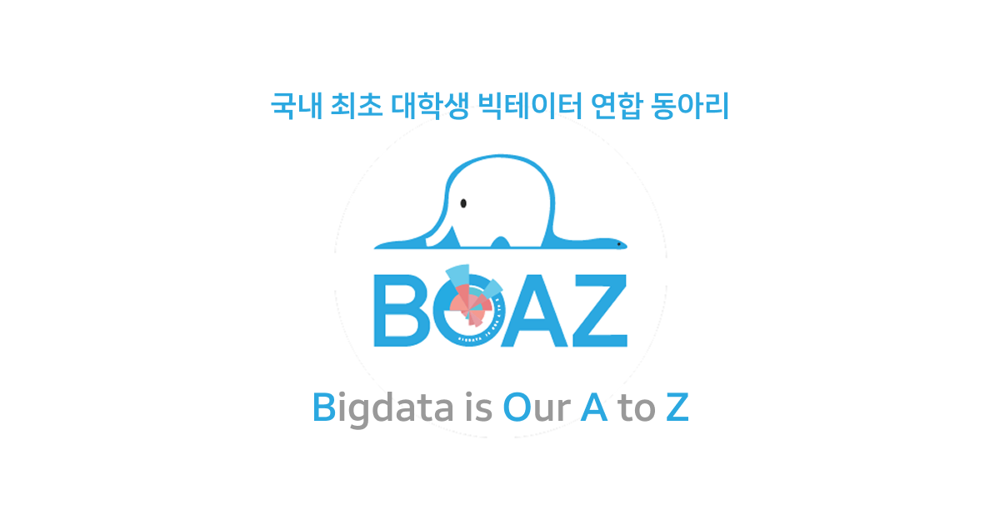

# BOAZ Design System

BOAZ 공개 홈페이지와 관리자 콘솔이 함께 쓰는 디자인 언어입니다. 디자인 토큰과 컴포넌트·패턴 명세를 단일 원천(Single Source of Truth)으로 관리하고, Style Dictionary로 빌드해 CSS 변수와 Tailwind 테마로 배포합니다. 명세를 토대로 두 앱이 함께 쓰는 React 컴포넌트도 이 저장소에서 구현합니다(Phase 2부터).

## Architecture

```text
core/tokens/ + home/tokens/ (DTCG JSON)  ──  npm run build  ──▶  dist/home/ (build artifacts)
home/src/ (React 컴포넌트)                                          ├── tokens.css          CSS 변수 --boaz-*
                                                                    ├── tokens.js, .d.ts    CSS 변수 참조 객체와 타입
                                                                    ├── tailwind-theme.css  Tailwind v4 @theme
                                                                    └── index.js, styles.css  컴포넌트
```

저장소는 공통 `core/`(글꼴)와 앱별 폴더 `home/`, `admin/`으로 나뉩니다. `admin/`은 지금 폴더만 있고, 내용은 이슈 #97에 따라 채웁니다([`admin/README.md`](./admin/README.md)).

```text
core/tokens/font.json     공통 글꼴 (글꼴 스택, 굵기)
home/tokens/              홈페이지 토큰
home/components/          홈페이지 컴포넌트 명세
home/patterns/            홈페이지 패턴과 가이드라인
home/docs/                홈페이지 디자인 참조
home/src/                 홈페이지 React 컴포넌트
admin/                    관리자 (tokens, components, patterns, src. 지금은 폴더만 있음)
```

## Foundations

- [`core/tokens/`](./core/tokens) — 두 앱 공통 글꼴 토큰 (글꼴 스택, 굵기)
- [`home/tokens/`](./home/tokens) — 홈페이지 Primitive(팔레트)·Semantic 토큰. 색, 타이포그래피, radius, spacing

## Components & Patterns

- [`home/components/`](./home/components) — 컴포넌트 명세 16종(`home/components/<id>.md`). 양식은 [`home/components/_template.md`](./home/components/_template.md)입니다.
- [`home/patterns/`](./home/patterns) — 패턴·가이드라인: feedback, form, accessibility, voice & tone
- `home/src/` — 명세를 구현한 React 컴포넌트. Phase 2(COMPONENT-17~26)에서 추가하며 첫 배포는 `v0.2.0`입니다. 할 일은 [`docs/wbs/30-component.md`](./docs/wbs/30-component.md) "구현" 절에 있습니다.

## Installation

git 태그로 설치합니다. 첫 버전 `v0.1.0`(파운데이션 토큰, 2026-10-11)부터 설치할 수 있고, 최신은 `v0.1.1`(`radius.xs` 추가)입니다. 버전 목록은 [Releases](https://github.com/BOAZ-website/design-system/releases)에 있습니다.

```bash
npm install github:BOAZ-website/design-system#v0.1.1
```

## Usage

아래 이름은 `v0.2.0`부터 씁니다. `v0.1.x`는 앱 이름 없이 `@boaz/design-system/tokens.css`, `@boaz/design-system/tailwind-theme.css`, `@boaz/design-system/tokens`를 씁니다.

```css
@import "@boaz/design-system/home/tokens.css";          /* CSS 변수 */
@import "@boaz/design-system/home/tailwind-theme.css";  /* Tailwind v4 (tokens.css 포함) */
@import "@boaz/design-system/home/styles.css";          /* 컴포넌트 CSS */
```

```ts
import { Button } from '@boaz/design-system/home';
import { vars } from '@boaz/design-system/home/tokens';

vars.color.palette.purple[100]; // "var(--boaz-color-palette-purple-100)"
```

크기·행간·간격·radius 토큰은 px입니다. 두 앱의 루트 글꼴 크기가 달라(frontend 10px, frontend_admin 14px) rem을 쓰면 같은 토큰이 앱마다 다른 크기로 보이기 때문입니다. 브라우저 확대는 px에도 적용됩니다.

## Documentation

처음 합류했다면 [`CONTRIBUTING.md`의 "처음 합류했다면"](./CONTRIBUTING.md#처음-합류했다면)부터 읽습니다.

- [`home/docs/design-reference.md`](./home/docs/design-reference.md) — 디자인 참조: Figma 원본 색·타이포·컴포넌트·에셋 기록
- [`docs/wbs/`](./docs/wbs) — 구축 로드맵 (WBS·작업 정의서). 작업 정의서는 할 일과 완료 조건을 정하고, 결과물의 정의는 `home/components/`, `home/patterns/`의 명세서에 있습니다.
- [`AGENTS.md`](./AGENTS.md) — 토큰 명명 규칙, 토큰·명세 작업 절차, 컴포넌트 구현 절차, breaking change 정책, 문서 작성 규칙
- [`CONTRIBUTING.md`](./CONTRIBUTING.md) — 처음 합류했을 때의 순서, 권한 체크리스트, 개발 환경, 브랜치·리뷰·커밋 규약

## License

[Apache-2.0](./LICENSE)
